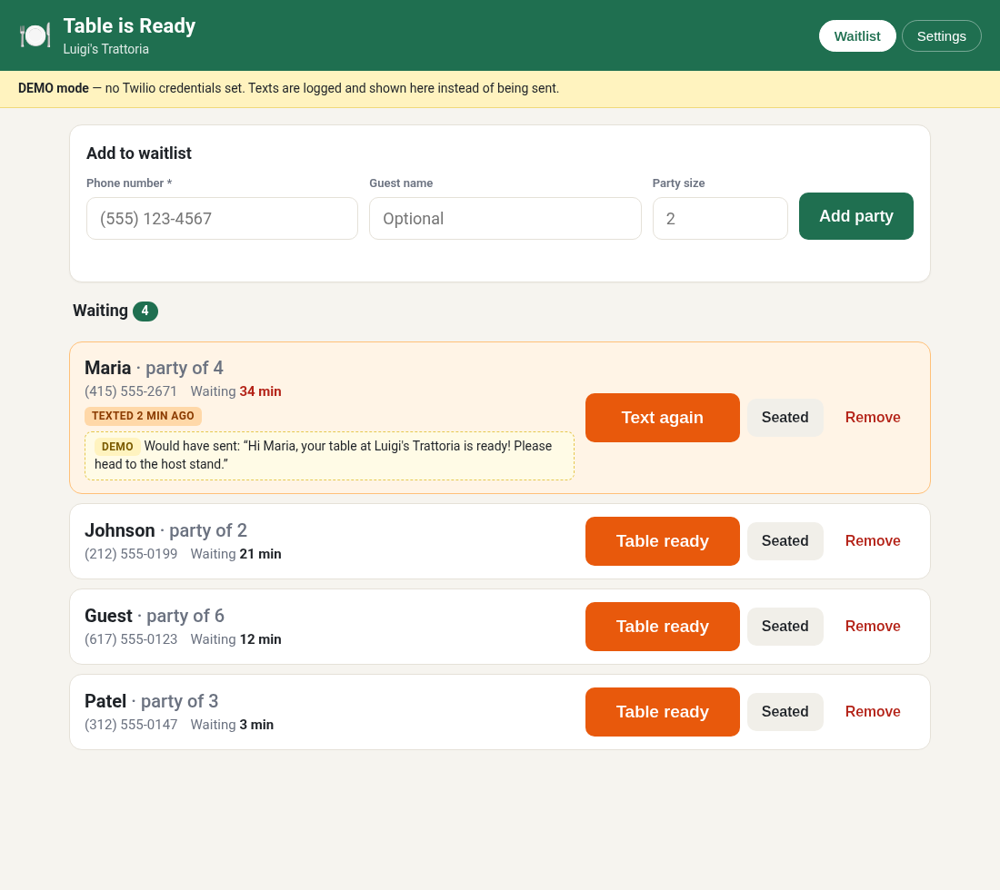

# Table is Ready

## About

Table is Ready makes waiting for a table easy. Instead of handing out buzzers or calling names across a crowded room, your host just types in a guest's phone number. When their table opens up, one tap sends them a friendly text so they know to come back. Guests can grab a drink, stroll the block, or relax in their car without worrying about missing their turn, and your staff keep the waitlist moving without the shouting. It works for restaurants, cafés, salons, clinics, or anywhere people wait in line, and it's simple enough to start using the same day.



A simple waitlist for restaurants (or any place with a line). The host enters a guest's
phone number when they join the waitlist; when their table is ready, the host taps
**Table ready** and the guest gets a text.

- Node.js + Express, SQLite (better-sqlite3), plain HTML/CSS/JS — no build step
- Tablet/phone-friendly host-stand screen with live wait times
- US phone numbers validated and stored as E.164 (`+14155552671`)
- SMS via Twilio, or **DEMO mode** (no credentials needed) that logs the text and shows
  "Would have sent: …" in the UI

## Quick start

```bash
npm install
cp .env.example .env     # optional — works without it in DEMO mode
npm start                # http://localhost:3000
```

`npm run dev` restarts on file changes.

> npm 11+ may block install scripts. If `better-sqlite3` fails to load, run
> `npm install-scripts approve better-sqlite3 && npm rebuild better-sqlite3`.
> Node 18–22 are supported with prebuilt binaries for better-sqlite3 v11.

## Using it

**Waitlist tab**
- Enter phone (required), name and party size (optional) → **Add party**
- Each party shows phone, party size, and time waiting (red after 30 min)
- **Table ready** sends the ready text and highlights the party as notified
  (button becomes **Text again**)
- **Seated** / **Remove** take the party off the active list (kept in the DB for history)
- The list auto-refreshes every 15 s, so several devices can share one waitlist

**Settings tab**
- Restaurant name, "table ready" message, optional "joined the waitlist" text, live preview
- Log of recent texts (sent / demo / failed)

Message placeholders: `{name}` (becomes "there" when no name), `{restaurant}`, `{size}`.
Default ready text: `Hi {name}, your table at {restaurant} is ready! Please head to the host stand.`

## Environment variables

| Variable | Default | Purpose |
|---|---|---|
| `PORT` | `3000` | HTTP port |
| `DATABASE_PATH` | `./data/table-is-ready.db` | SQLite file |
| `RESTAURANT_NAME` | `Our Restaurant` | Default restaurant name |
| `READY_MESSAGE_TEMPLATE` | see above | Default ready text |
| `JOIN_MESSAGE_TEMPLATE` | `You're on the waitlist at {restaurant}. …` | Join text |
| `JOIN_SMS_ENABLED` | `false` | Text guests when they're added |
| `TWILIO_ACCOUNT_SID` | – | Twilio Account SID (`AC…`) |
| `TWILIO_AUTH_TOKEN` | – | Twilio auth token |
| `TWILIO_FROM_NUMBER` | – | Your Twilio number in E.164, e.g. `+14155550100` |
| `SMS_PROVIDER` | auto | Set to `demo` to force DEMO mode |

Values saved on the Settings page override the `.env` defaults.
If any of the three Twilio variables is missing, the app runs in DEMO mode.

## Sending real texts

1. Create a Twilio account and buy an SMS-capable US number.
2. For US 10-digit numbers, register for **A2P 10DLC** (or use a verified toll-free number) —
   unregistered traffic is filtered by carriers. Trial accounts can only text verified numbers.
3. Put `TWILIO_ACCOUNT_SID`, `TWILIO_AUTH_TOKEN`, `TWILIO_FROM_NUMBER` in `.env` and restart.

If a send fails (bad credentials, unverified number…), the party stays on the list
unchanged and the error is shown to the host.

## Swapping SMS providers

`src/sms.js` defines a tiny interface — `{ name, demo, send({ to, body }) → { id, status } }`.
Add a factory (e.g. `createVonageSender`) and select it in `createSender()`.

## API

| Method | Path | |
|---|---|---|
| GET | `/api/status` | provider, demo flag, settings |
| GET/PUT | `/api/settings` | read / update settings |
| GET | `/api/parties` | active parties (`?all=1` for all) |
| POST | `/api/parties` | `{ phone, name?, party_size? }` |
| POST | `/api/parties/:id/ready` | send ready text, mark notified |
| POST | `/api/parties/:id/seat` | mark seated |
| DELETE | `/api/parties/:id` | remove from waitlist |
| GET | `/api/messages` | last 50 texts |

## Layout

```
src/server.js   entry point (env, DB, sender, listen)
src/app.js      Express routes + message templating
src/db.js       SQLite schema
src/sms.js      SMS sender interface: Twilio + demo
src/phone.js    US phone → E.164
public/         host-stand UI (index.html, styles.css, app.js)
```
